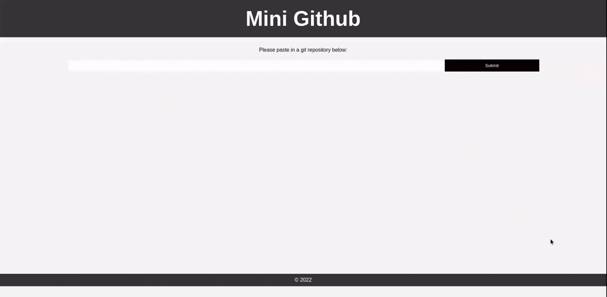

# simple_mini_github

A simple app to test out `irmin-graphql`, `dream` and `js_of_ocaml`



## How to setup the project

- clone the repository
- Run `make install` to install all project dependencies
- Run `make start` to start the application
- Open `localhost:8080` in the browser to view the project frontend
- Open `http://localhost:8080/graphiql` in the browser to view graphiql

## To test

- Paste in a github repository in the input box on the frontend
- Run this sample query on graphiql to see result

```gql
  {
    branches {
      name
      head {
        info {
          date
          author
          message
        }
      }
    }
    main {
      tree {
        get_contents(path:"/README.md") {
          metadata
          value
          hash
        }
      }
    }
  }
```
